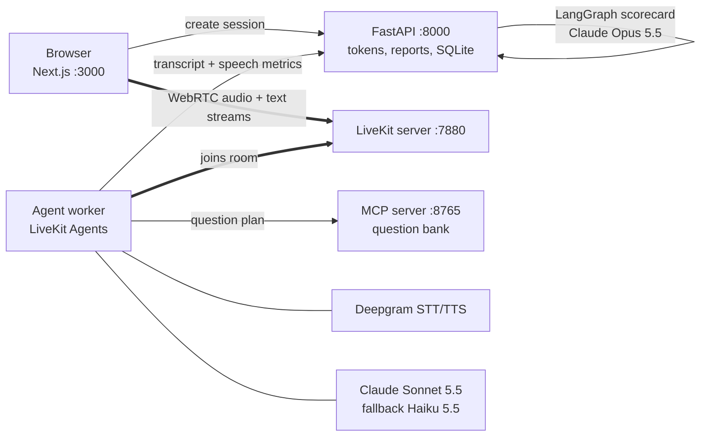

# Interview Coach

A voice agent that runs a realistic mock job interview for any role, then gives you a scorecard: a grade for every answer with quotes from what you said, the speech habits only a voice interview reveals (pace, filler words, pauses, how long you took to start), and a short coaching plan.

Built with **LiveKit Agents**, **Claude**, **Deepgram**, an **MCP** question bank, a **LangGraph** grading pipeline, **FastAPI** and **Next.js**.

## What it does well

| Hard part of voice | How it's handled | Where |
|---|---|---|
| **Not cutting off a thinking candidate** | A semantic turn detector decides whether you finished your thought; the agent waits up to 6 s through a mid-answer pause, but replies within about a second when you're done. | `agent/session_config.py` (`turn_handling`) |
| **Interruptions** | You can talk over the interviewer and it stops. An "mm-hmm" doesn't count: an interruption needs two words, and a false start resumes the sentence. | same |
| **Latency** | Claude starts drafting before you've definitely finished (preemptive generation). Live turns run Sonnet 5.5 with thinking off and low effort. Every reply's delay is measured and shown. | `agent/llm.py`, `agent/telemetry.py` |
| **Sounding like an interviewer, not a chatbot** | One question at a time, short turns, no feedback mid-interview, follow-ups that probe what's missing (usually the result). Markdown and URLs are stripped before speech. | `agent/prompts.py`, `agent/speakable.py` |
| **Feedback a text chatbot can't give** | Deepgram keeps "um" and "uh" and word timings, so each answer gets pace, filler rate, longest pause and thinking time. | `agent/analytics.py` |
| **Grading you can trust** | Each answer is graded separately against a rubric by Claude Opus 5.5 with structured output; quotes must be the candidate's own words; a calibration eval checks a strong answer beats a weak one. | `scorecard/graph.py`, `tests/evals/` |
| **Things going wrong** | Claude and text-to-speech fall back to a second provider mid-call, the question bank falls back to a bundled copy, a dropped call still produces a partial scorecard, and a failed upload is retried then saved to disk. | `agent/worker.py`, `agent/completion.py` |

## Why it's built this way

| What an interview needs | Choice |
|---|---|
| A scheduled one-on-one session that could later be recorded or observed | LiveKit Agents on a LiveKit server (rooms), with explicit agent dispatch |
| Candidates pause to think | Turn detector plus a long maximum endpointing delay |
| Analytics need exact words, including fillers, and timings | A cascaded pipeline (speech-to-text → Claude → text-to-speech). A speech-to-speech model would hide this data. |
| Smart follow-ups; a short pause before replying is normal | Claude Sonnet 5.5 for live turns |
| Careful, consistent grading; latency doesn't matter | A LangGraph map-reduce on Claude Opus 5.5 after the call |
| A question bank that's useful outside this app | An MCP server; Claude Desktop or Claude Code can use it too |

## Architecture



The agent worker is real-time only. When the interview ends it posts the transcript and speech metrics to the API, which grades in the background, so a slow or failed grading run never affects a live call.

**One answer, end to end:**
1. The interviewer asks question 2. The `next_question` tool marks where the answer starts, and the UI's progress bar moves.
2. You think for three seconds, which is recorded as thinking time, and pause mid-answer. The turn detector judges the sentence unfinished and waits.
3. You finish. Claude has already started drafting, the reply streams into speech, and the latency strip shows how long it took.
4. At the end, LangGraph grades each answer in parallel, combines the grades, and writes the coaching plan.

## Quick start (Docker)

You need an [Anthropic API key](https://console.anthropic.com/) and a [Deepgram API key](https://console.deepgram.com/); both have free credits. The LiveKit server runs locally in dev mode, so no LiveKit account is needed.

```bash
cp .env.example .env
```

Put your two keys in `.env`, then:

```bash
docker compose up --build
```

Open http://localhost:3000, pick a role, and click **Start interview**. Your browser will ask for microphone access.

## Development setup

Python 3.12 with [uv](https://docs.astral.sh/uv/) and Node 24.

```bash
uv sync
```

```bash
uv run python -m interview_coach.agent.worker download-files
```

Run each of these in its own terminal:

```bash
docker run --rm -p 7880:7880 -p 7881:7881 -p 7882:7882/udp livekit/livekit-server --dev --bind 0.0.0.0 --node-ip 127.0.0.1
```

```bash
uv run coach-mcp
```

```bash
uv run coach-api
```

```bash
uv run coach-agent dev
```

```bash
npm --prefix web install && npm --prefix web run dev
```

### Use the question bank from Claude

The MCP server works with any MCP client. With `coach-mcp` running, add `http://localhost:8765/mcp` as a streamable HTTP server in Claude Desktop or Claude Code and ask for "five behavioral questions for a senior product manager".

### Tracing

Set `OTEL_EXPORTER_OTLP_ENDPOINT` to send LiveKit's OpenTelemetry spans (speech-to-text, LLM and TTS timings per turn) to Langfuse, Jaeger or any OTLP collector.

## How the scorecard works

1. **Segment.** Everything you said between one `next_question` call and the next, follow-ups included, is one answer.
2. **Grade in parallel.** LangGraph sends each answered question to Claude Opus 5.5 with the rubric (structure, specificity, impact, relevance, communication, each 1 to 5) and gets back a validated `AnswerGrade` through structured outputs. Unanswered questions are listed as skipped, not graded.
3. **Combine.** Structure and impact count 1.5 times as much as the other three dimensions. The weighted mean maps onto a 0 to 100 score.
4. **Coach.** A final call writes three fixes, rewrites your weakest answer in STAR form using only facts you gave (missing facts become placeholders like `[number]`), and suggests a ten-minute drill.

## Tests and evals

```bash
uv run pytest
```

This runs 97 unit tests in about 20 seconds with no API keys: analytics, the question bank and MCP server, the LangGraph pipeline with a fake grader, the API, latency tracking, completion delivery and turn-taking settings.

```bash
uv run pytest -m eval
```

This runs against the real Claude API and needs `ANTHROPIC_API_KEY`. It includes LiveKit's text-mode test harness with an LLM judge:
- the interviewer opens by calling `next_question`
- a vague answer gets a follow-up about the result
- "how did I do?" is deferred to the scorecard
- an off-topic request is redirected
- replies stay at three sentences or fewer with no markdown
- "I need to stop" calls `end_interview`

It also includes a grader calibration check: across three fixture pairs, the strong answer must beat the weak one by at least 15 points on average over three runs.

```bash
npm --prefix web run typecheck && npm --prefix web run build
```

CI (`.github/workflows/interview-coach.yml`) runs the unit tests, lint and web build on every change, and runs the evals when the `ANTHROPIC_API_KEY` secret is set.

## Reading the latency strip

Each bar is one reply. Its height is the time from when you stopped talking to when the interviewer's voice started. Hover a bar for the breakdown:
- **End of turn:** how long the turn detector waited to be sure you'd finished. This is deliberately patient in an interview.
- **First word from Claude:** time to the first token.
- **First audio:** time until text-to-speech produced sound.

Bars over 1.5 s turn amber. The report shows the median and slowest reply for the whole interview.

## Known limitations

- **Local and single-user.** There's no login, and the agent authenticates to the API with a shared secret.
- **Thinking blocks and tool calls.** LiveKit's Anthropic plugin doesn't keep Claude's thinking blocks in history. Live turns use Sonnet 5.5's lowest thinking setting, which can still emit a progress note between tool calls. If the evals ever show API errors on a tool turn, set `LIVE_MODEL=claude-haiku-5-5`; the fallback adapter already switches to Haiku when that happens mid-call.
- **Approximate absolute timings.** Speech timings are anchored to when each final transcript arrives, so they can be off by speech-to-text latency (a few hundred milliseconds). Pace, fillers and pauses within an answer are exact.
- **Deprecated turn detector.** It uses LiveKit's local `turn_detector` plugin, which is deprecated in favor of a LiveKit Cloud inference version that needs a cloud account. Switch when deploying to LiveKit Cloud.
- **No phone calls yet.** LiveKit SIP could put the same agent on a phone number, and that's a natural next step.

## Project layout

```
src/interview_coach/
  agent/        worker, interviewer, prompts, analytics, telemetry, completion, LLM options
  mcp_server/   MCP server and question bank
  scorecard/    LangGraph pipeline and models
  api/          FastAPI app and SQLite store
web/            Next.js app: setup, live interview, scorecard
tests/unit/     no-key tests
tests/evals/    Claude-backed behavior and calibration evals
docs/           design spec and implementation plan
```
